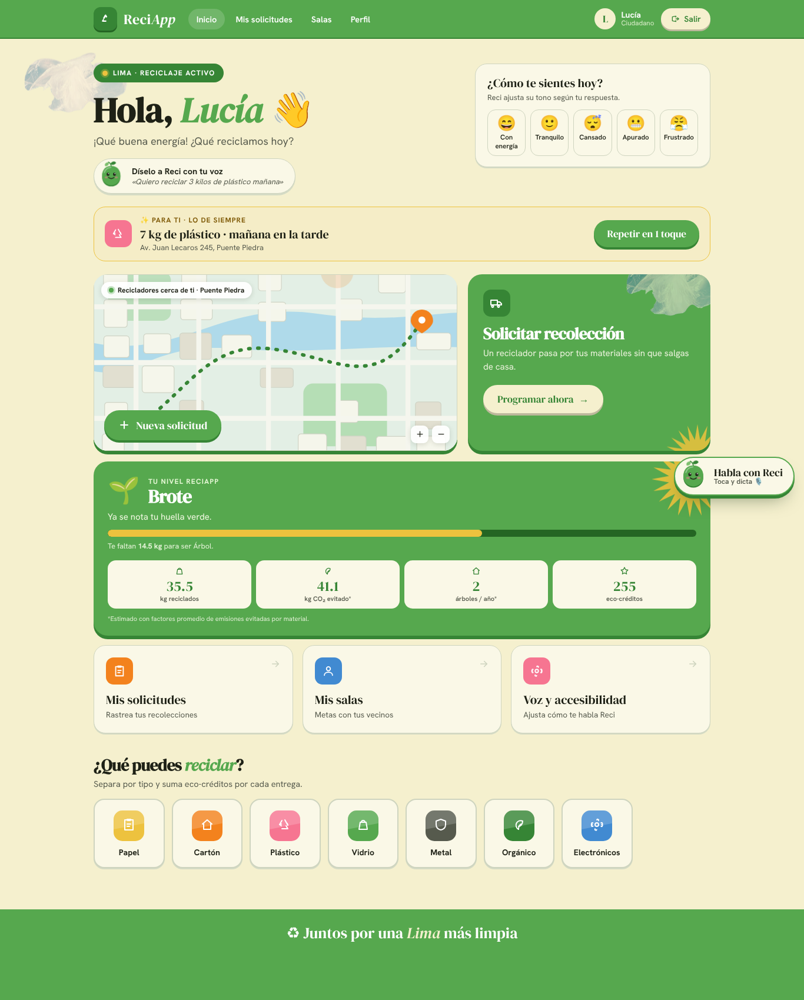
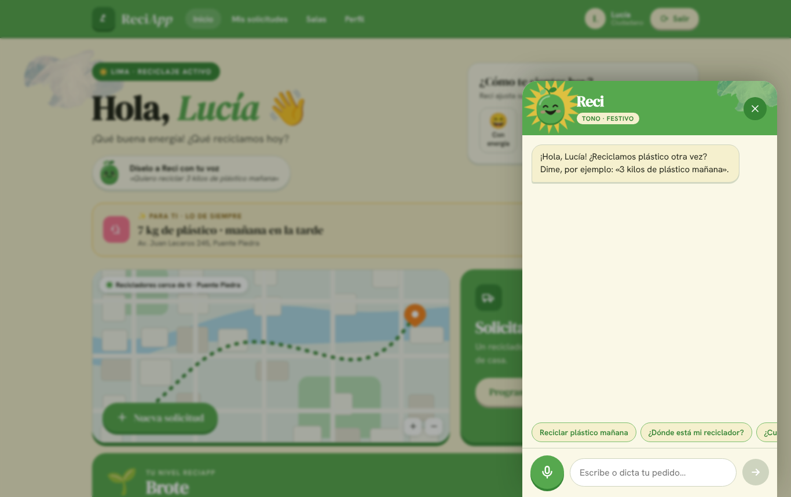
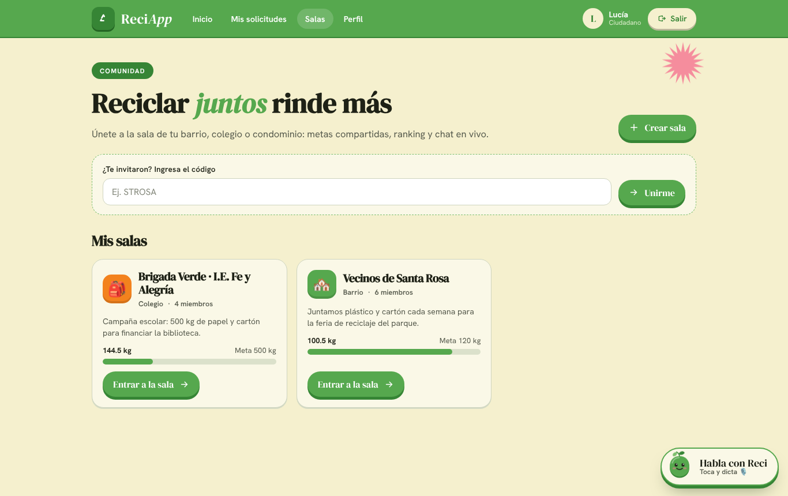
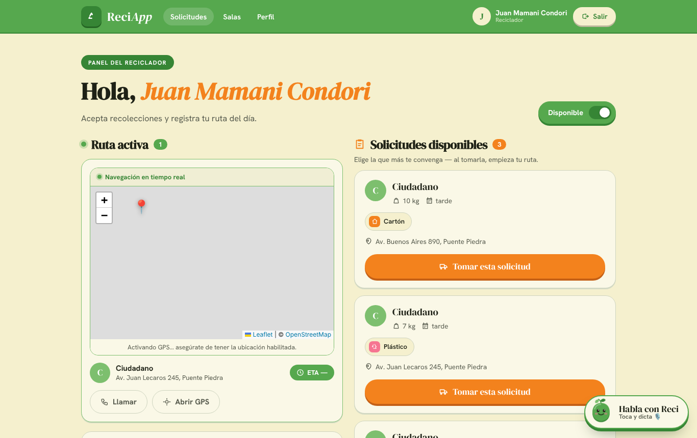
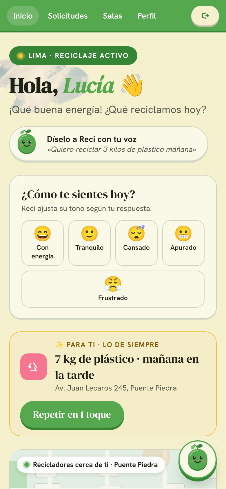

 

 

## Sobre mí

Estudio Ciencias de la Computación en la **Universidad Nacional de Ingeniería** (7.º ciclo, 2023 – presente) y formo parte del **décimo superior**. Obtuve el **2.º puesto en Ciencias de la Computación** en el periodo 2025-I.

Me interesa combinar el desarrollo de software con la inteligencia artificial. Trabajo en equipo con metodologías ágiles (Scrum, Jira) y soy cofundadora de **[MasQuePrompt](https://www.masqueprompt.org/)**, una iniciativa que enseña a estudiantes de secundaria cómo funciona la IA mediante talleres y herramientas interactivas.

Con un brazo robótico de visión artificial que clasifica residuos obtuve el **2.º puesto ABET** (categoría I-IV).

 

## Tecnologías

 

 

## Proyectos destacados

### ReciApp: gestión de residuos y economía circular

Plataforma web desarrollada en equipo (09/2025 – 12/2025) para facilitar la recolección de residuos mediante **rutas calculadas en tiempo real**. Implementé el ruteo con **WebSockets** y el algoritmo **A\***, con mapas interactivos en **React y Leaflet** sobre un backend en **FastAPI**.

 

### OpenAI Cubes: CNN distribuida políglota

Red neuronal convolucional **escrita desde cero**, sin librerías de aprendizaje automático. Su cálculo se reparte entre nodos en **Java, Python, Go y Node.js** mediante un protocolo binario propio sobre TCP.

| Resultado | Valor |
|---|---|
| Consistencia entre lenguajes | Diferencia máxima de 10⁻⁷ |
| Precisión | De 71,7 % a **78,2 %** (data augmentation, learning rate coseno y TTA) |
| Entrenamiento | **×3,7 más rápido** con 4 hilos |
| Concurrencia | 400 clientes simultáneos, con reasignación del trabajo de nodos caídos |

 

### Análisis exploratorio de focos de calor en Cusco

Análisis de **39 997 focos de calor satelitales** (NASA FIRMS VIIRS, 2013 – 2025) con Pandas, NumPy, Shapely, Matplotlib y Seaborn: limpieza, unión espacial por provincia y visualización.

| Hallazgo | Dato |
|---|---|
| Estacionalidad | El **75,6 %** de los focos ocurre entre agosto y octubre |
| Año anómalo | 2020, el único con z = 2,42 |
| Concentración geográfica | **La Convención** reúne el 54 % de la actividad |

 

### Conteo de cartas Hi-Lo en Blackjack

Sistema de **visión por computadora clásica**, sin redes neuronales, que detecta, clasifica y cuenta cartas en video y calcula el *Running Count* y el *True Count* en tiempo real. Es robusto ante la vibración de la cámara y la oclusión por manos gracias a la estabilización con flujo óptico **Lucas-Kanade y RANSAC** y al consenso multi-frame.

 

## Actividad en GitHub

